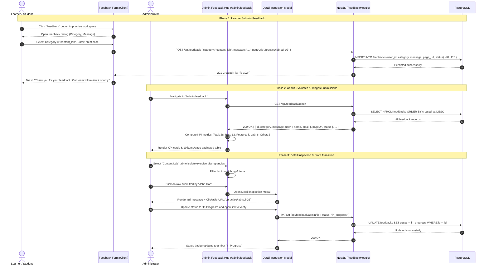

# Sequence Diagram: User Feedback Collection & Admin Resolution Loop (User Feedback Loop Flow)

## 1. Document Information

| Attribute | Details |
|---|---|
| **Document Title** | User Feedback Collection & Admin Resolution Loop Workflow |
| **Version** | v1.0 |
| **Author** | Nguyen Khanh Duy (Fullstack Lead & Architect) |
| **Scope** | End-to-end user feedback cycle: From in-app user submission of bug reports or suggestions, database persistence, to Administrator inspection, categorization (`bug`, `feature_request`, `content_lab`, `other`), contextual page URL navigation, and triage tracking at `/admin/feedback` |
| **Date** | 2026-10-14 |
| **Source Reference** | `MODULE_FE/src/pages/admin/AdminFeedbackPage.tsx`, `MODULE_BE/src/modules/feedback/feedback.controller.ts`, `MODULE_BE/src/modules/feedback/feedback.service.ts` |

---

## 2. Core Content

### 2.1. Workflow Summary (TL;DR)
- **Feedback Collection (Learner Touchpoint)**:
  - Learner clicks the "Feedback" widget button in the footer or workspace toolbar.
  - Chooses category: `bug` (software issue), `feature_request` (new feature idea), `content_lab` (exercise discrepancy), `other` (general inquiry).
  - Enters detailed text; the client automatically attaches the active route pathname (`page_url`) and user ID.
  - Submits `POST /api/feedback` to persist in PostgreSQL.
- **Administration & Resolution (Admin Hub `/admin/feedback`)**:
  - High-level KPI summary cards: Total Feedbacks, Bugs, Feature Requests, and Content Lab issues.
  - Category filter tabs, keyword search bar, and standardized 10 items/page pagination.
  - Clicking any row opens the **Detail Inspection Modal**: Displays full feedback text, clickable issue origin URL, and triage state actions (`open`, `in_progress`, `resolved`).

---

### 2.2. Roles & Responsibilities (Who Does What)

| Entity | Type | Roles & Responsibilities |
|---|---|---|
| **Learner / Guest** | Actor | Submits feedback forms, reports bugs or suggests improvements |
| **Feedback Widget / Modal** | Client UI | Modal collecting category, message, automatically capturing `window.location.pathname` |
| **Administrator** | Actor | Monitors `/admin/feedback`, inspects context, updates status |
| **AdminFeedbackPage** | Client UI | KPI metric cards, category filtering, search, pagination, and inspection modal |
| **Feedback Controller & Service** | NestJS Backend | Validates input, saves records, provides `@Roles('admin')` protected query endpoints |
| **PostgreSQL Database** | Storage | Houses `feedbacks` table (`id`, `userId`, `category`, `message`, `pageUrl`, `status`, `createdAt`) |

---

### 2.3. Sequence Diagram

---

### 2.4. Technical Specifications & Architecture Details

1. **High-Level KPI Metric Cards**:
   - The `/admin/feedback` interface surfaces four summary metrics:
     - Card 1: Total Received Submissions
     - Card 2: Software Bug Reports
     - Card 3: Feature Requests
     - Card 4: Lab & Content Suggestions
2. **Contextual Origin Tracking**:
   - The `page_url` attribute is automatically captured upon dialog open.
   - In the Admin modal, this URL renders as an active deep-link, enabling administrators to jump directly to the reported exercise without manual navigation.
3. **Client-Side Responsive Pagination**:
   - Integrated with `DataTablePagination`, ensuring sub-second response times across large feedback volumes.

---

### 2.5. Edge Cases & Exception Handling

| Edge Case | System Response | User Experience |
|---|---|---|
| **Unauthenticated Guest Feedback** | Backend accepts `user_id = NULL` with valid contact email | Guests can report bugs without forced registration |
| **Short or Spammy Content** | Form enforces minimum 10-character threshold | Submit button remains disabled with guidance: *"Please provide at least 10 characters"* |
| **Unauthorized Access to Feedback API** | Guard `@Roles(UserRole.ADMIN)` blocks non-admin callers | Responds with 403 Forbidden |

---

## 3. References & Source Links

- **Frontend Codebase**:
  - Admin Feedback Page: [AdminFeedbackPage.tsx](file:///d:/Projects/study-web/MODULE_FE/src/pages/admin/AdminFeedbackPage.tsx)
  - Feedback Admin API: [feedback.admin.api.ts](file:///d:/Projects/study-web/MODULE_FE/src/features/admin/api/feedback.admin.api.ts)
  - Pagination Component: [data-table-pagination.tsx](file:///d:/Projects/study-web/MODULE_FE/src/components/ui/data-table-pagination.tsx)
- **Backend Codebase**:
  - Feedback Controller: [feedback.controller.ts](file:///d:/Projects/study-web/MODULE_BE/src/modules/feedback/feedback.controller.ts)
  - Feedback Service: [feedback.service.ts](file:///d:/Projects/study-web/MODULE_BE/src/modules/feedback/feedback.service.ts)
- **Related Workflows**:
  - Admin Users Governance: [09-admin-users-and-entitlements.md](file:///d:/Projects/study-web/docs/workflows/09-admin-users-and-entitlements.md)
  - User Group Management: [10-admin-user-groups-split-view.md](file:///d:/Projects/study-web/docs/workflows/10-admin-user-groups-split-view.md)
