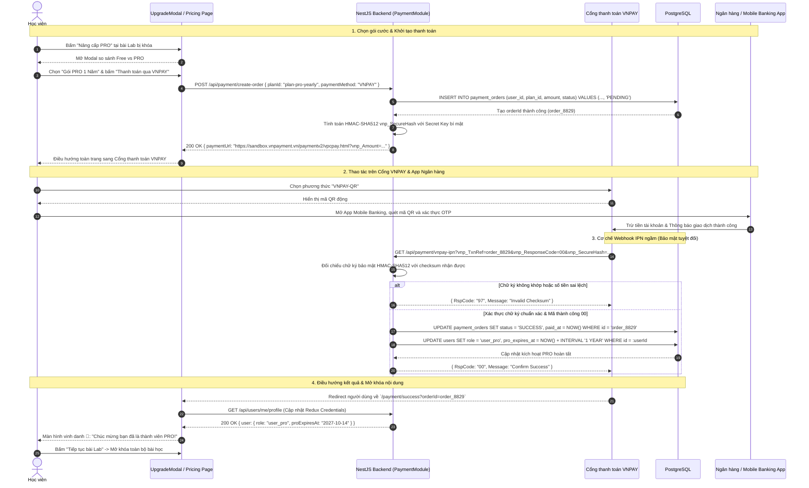

# Sơ đồ Luồng Nâng cấp Tài khoản PRO & Thanh toán Cổng VNPAY (Upgrade & Payment Flow)

## 1. Thông tin tài liệu (Document Information)

| Thuộc tính | Chi tiết |
|---|---|
| **Tên tài liệu** | Sơ đồ Luồng Nâng cấp Tài khoản PRO & Thanh toán Cổng VNPAY |
| **Version** | v1.1 |
| **Người làm** | Nguyen Khanh Duy (Fullstack Lead & Architect) |
| **Phạm vi (Scope)** | Hành trình người dùng từ Popup Paywall / Trang Bảng giá (`/pricing`), chọn gói PRO (tháng/năm), khởi tạo phiên giao dịch, chuyển hướng qua Cổng thanh toán VNPAY, xử lý Webhook IPN đối soát chữ ký SHA256, và kích hoạt quyền PRO ngay tức thì |
| **Thời gian** | 2026-10-14 |
| **Tham chiếu từ** | `MODULE_FE/src/features/lab/components/UpgradeModal.tsx`, `MODULE_BE/src/modules/payment/payment.controller.ts`, `MODULE_BE/src/modules/payment/vnpay.service.ts` |

---

## 2. Nội dung chính (Content)

### 2.1. Tóm tắt luồng (TL;DR)
- **Đầu vào**: Học viên gặp bài Lab có cờ `requiresPro = true` hoặc bấm "Nâng cấp PRO" trên thanh Header.
- **Chọn gói**: Mở modal / trang Bảng giá, chọn gói Tháng (Ví dụ: 199.000 VNĐ) hoặc gói Năm (Ví dụ: 1.490.000 VNĐ).
- **Thanh toán VNPAY**:
  - Backend sinh URL thanh toán có gắn chữ ký bảo mật `vnp_SecureHash` (HMAC-SHA512).
  - Trình duyệt chuyển sang cổng VNPAY để người học quét mã VNPAY-QR hoặc nhập thẻ ATM.
- **Xác thực & Kích hoạt**:
  - VNPAY gọi webhook ngầm (Instant Payment Notification - IPN) về Backend để đối soát tính toàn vẹn chữ ký và trạng thái giao dịch.
  - Backend cập nhật role `user_pro`, cấp hạn sử dụng và lưu lịch sử thanh toán vào `payment_orders`.
  - Học viên được chuyển hướng về trang Chúc mừng và mở khóa toàn bộ bài Lab ngay lập tức.

---

### 2.2. Phân công & Vai trò (Who does what)

| Thực thể | Loại | Vai trò & Trách nhiệm trong luồng |
|---|---|---|
| **Học viên** | Actor | Chọn gói cước, quét mã QR thanh toán trên ứng dụng ngân hàng |
| **UpgradeModal / Pricing UI** | Client UI | Hiển thị quyền lợi PRO, bảng so sánh và nút "Thanh toán qua VNPAY" |
| **Payment Controller & Service** | NestJS Backend | Sinh URL thanh toán VNPAY, tính hash HMAC-SHA512, tiếp nhận IPN Webhook |
| **Cổng thanh toán VNPAY** | Payment Gateway | Xử lý thanh toán ngân hàng, điều hướng người dùng và gửi thông báo IPN |
| **PostgreSQL Database** | Storage | Bảng `payment_orders`, `users` (cập nhật role = 'user_pro', pro_expires_at) |

---

### 2.3. Sơ đồ Tuần tự (Sequence Diagram)

---

### 2.4. Phân tích Kỹ thuật Chi tiết

1. **Bảo mật Kiểm tra Kép (Dual Check: Return URL vs IPN)**:
   - **Return URL (Client Redirect)**: Phục vụ trải nghiệm UI của người dùng để không phải chờ đợi.
   - **IPN Webhook (Server-to-Server)**: Kênh chính thống duy nhất để quyết định kích hoạt quyền hạn trong CSDL. Kể cả người dùng có tắt trình duyệt giữa chừng sau khi chuyển tiền trên App ngân hàng, tài khoản vẫn được tự động kích hoạt nhờ IPN.
2. **Xác thực Chữ ký HMAC-SHA512**:
   - Mọi thông số gửi đi và nhận về đều được sắp xếp theo bảng chữ cái alphabet và băm cùng chuỗi khóa bí mật `VNPAY_HASH_SECRET`. Bất kỳ hành vi can thiệp sửa đổi giá trị tiền `vnp_Amount` hay mã đơn hàng đều sẽ bị phát hiện và từ chối ngay tức khắc.
3. **Quản lý Hạn dùng Động (Subscription Expiry Calculation)**:
   - Khi gia hạn: Nếu tài khoản đang còn hạn PRO, thời gian của gói mới được cộng dồn (Stacking) tiếp vào ngày hết hạn hiện tại thay vì ghi đè từ thời điểm hiện tại.

---

### 2.5. Xử lý Ngoại lệ (Edge Cases)

| Tình huống ngoại lệ | Phản hồi hệ thống | Trải nghiệm người dùng |
|---|---|---|
| **Người dùng bấm "Hủy giao dịch" trên cổng VNPAY** | VNPAY redirect về trang web kèm mã `vnp_ResponseCode = 24` | Hiển thị màn hình thông báo *"Giao dịch đã bị hủy. Bạn có thể thử lại khi sẵn sàng"* |
| **Mất kết nối mạng trong lúc quét QR** | VNPAY timeout sau 15 phút không thanh toán | Đơn hàng tự động hủy với trạng thái `EXPIRED` |
| **Webhook IPN bị trễ do nghẽn mạng ngân hàng** | Frontend có cơ chế polling nhẹ kiểm tra trạng thái đơn hàng | Hiển thị spinner: *"Đang kiểm tra giao dịch của bạn..."* và tự động cập nhật ngay khi IPN tới |

---

## 3. Tài liệu tham khảo & Liên kết (References)

- **Mã nguồn Frontend**:
  - Modal Nâng cấp PRO: [MODULE_FE/src/features/lab/components/UpgradeModal.tsx](file:///d:/Projects/study-web/MODULE_FE/src/features/lab/components/UpgradeModal.tsx)
  - Quản trị Gói Cước Admin: [MODULE_FE/src/pages/admin/AdminPlansPage.tsx](file:///d:/Projects/study-web/MODULE_FE/src/pages/admin/AdminPlansPage.tsx)
- **Mã nguồn Backend**:
  - Payment Controller: [MODULE_BE/src/modules/payment/payment.controller.ts](file:///d:/Projects/study-web/MODULE_BE/src/modules/payment/payment.controller.ts)
  - VNPAY Service: [MODULE_BE/src/modules/payment/vnpay.service.ts](file:///d:/Projects/study-web/MODULE_BE/src/modules/payment/vnpay.service.ts)
- **Tài liệu liên quan**:
  - Luồng Khám phá Khóa học & Paywall: [02-catalog-topic-discovery.md](file:///d:/Projects/study-web/docs/workflows/02-catalog-topic-discovery.md)
  - Luồng Quản trị Người dùng & Quyền hạn: [09-admin-users-and-entitlements.md](file:///d:/Projects/study-web/docs/workflows/09-admin-users-and-entitlements.md)
