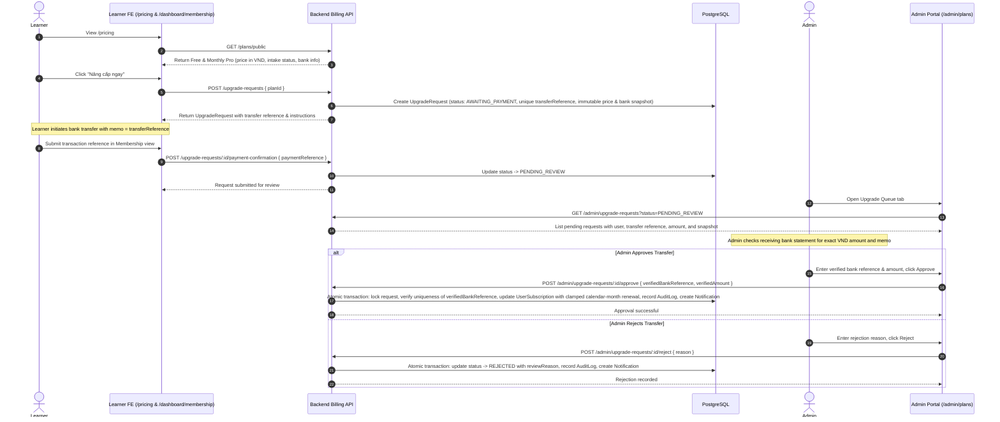

# PRO Access, Pricing, Manual Upgrade, and Payment Boundary

## 1. Document Information

| Attribute | Detail |
|---|---|
| Document | PRO Access, Pricing, Manual Upgrade, and Payment Boundary |
| Version | 2.1 — Manual Bank-Transfer Milestone & Completion Gate |
| Owner | Nguyen Khanh Duy — Fullstack Lead & Architect |
| Scope | Database-driven pricing, manual bank-transfer upgrade request lifecycle, admin reconciliation, calendar renewal arithmetic, solution completion gate, and unimplemented automated payment gateway boundary |
| Date | 2026-10-26 |
| Source | `MODULE_BE/src/modules/billing`, `MODULE_BE/src/modules/entitlements`, `MODULE_FE/src/features/billing`, `MODULE_FE/src/pages/PricingPage.tsx`, `MODULE_ADMIN/src/pages/admin/AdminPlansPage.tsx`, and Prisma schema |

## 2. Content

### 2.1. Truth summary

| Capability | Status | Current behavior |
|---|---|---|
| PRO lab gate | `IMPLEMENTED` | Permission checks hide instructions/code and show an upgrade modal or locked state. |
| Solution completion gate | `IMPLEMENTED` | Learners require unit completion (`COMPLETED` progress status) to unlock reference solutions, even with active PRO entitlement. Admins and series authors retain authoring preview access. |
| Pricing comparison | `IMPLEMENTED` | Dynamic database-driven pricing via `GET /plans/public`. Displays Free and Monthly Pro in integer VND. No annual toggle in v1. |
| Upgrade request lifecycle | `IMPLEMENTED` | In-app flow: `AWAITING_PAYMENT -> PENDING_REVIEW -> APPROVED \| REJECTED`. Learner initiates request with server-generated unique transfer reference and bank snapshot. |
| Manual transfer reconciliation | `IMPLEMENTED` | Learner submits bank transaction reference; Admin verifies bank statement and approves with verified reference and exact VND amount. Rollback and concurrency are strictly transactional. |
| Calendar renewal arithmetic | `IMPLEMENTED` | Renewal adds one calendar month with day clamping (e.g., Jan 31 -> Feb 28/29) preserving UTC time of day. Early renewal extends from active `endDate`; expired memberships start at approval. |
| In-app notifications & expiry reminders | `IMPLEMENTED` | Persistent inbox, unread counts, upgrade status notifications, 3-day pre-expiry warning, and expiry notices driven by a distributed scheduled job lease (`ScheduledJobLease`). |
| Automated gateways (VNPAY / MoMo / Stripe) | `EXTERNAL` / not implemented | No payment gateway SDK, card processing, or automated IPN webhooks exist in this repository. Blocked under PB-24 pending business/legal decisions. |

### 2.2. Learner & Admin Upgrade Lifecycle Flow

### 2.3. Upgrade State Machine Specification

1. **State `AWAITING_PAYMENT`**:
   - Initiated by authenticated learner via `POST /upgrade-requests`.
   - Server validates intake is enabled (`BillingSettings.isIntakeEnabled === true`) and the target plan is public and sale-ready (`isPublic && isSaleReady`).
   - If user already has an open request in `AWAITING_PAYMENT` or `PENDING_REVIEW`, the server returns the existing request instead of creating duplicates.
   - Learner can voluntarily cancel via `POST /upgrade-requests/:id/cancel`, transitioning state to `CANCELLED`.
2. **State `PENDING_REVIEW`**:
   - Learner confirms payment by providing their bank transaction reference via `POST /upgrade-requests/:id/payment-confirmation`.
   - Once in `PENDING_REVIEW`, the request is locked from learner cancellation or modification.
3. **State `APPROVED` (Terminal)**:
   - Admin executes `POST /admin/upgrade-requests/:id/approve` supplying `verifiedBankReference` and `verifiedAmount`.
   - Backend enforces exact match between `verifiedAmount` and `priceSnapshot`.
   - Backend enforces global uniqueness on `verifiedBankReference` to prevent double-crediting.
   - User subscription is atomically granted or extended:
     - If user has active non-expired subscription: `newEndDate = clampMonth(currentEndDate, +1)`.
     - If user has expired or no subscription: `newEndDate = clampMonth(now, +1)`.
   - In-app notification (`UPGRADE_APPROVED`) and audit log (`UPGRADE_REQUEST_APPROVE`) are written in the same database transaction.
4. **State `REJECTED` (Terminal)**:
   - Admin executes `POST /admin/upgrade-requests/:id/reject` supplying a mandatory `reason`.
   - Learner receives an in-app notification (`UPGRADE_REJECTED`) containing the reason and instructions on how to retry.

### 2.4. Learner Solution Completion Gate

To preserve educational integrity, PRO subscribers cannot view reference solutions before legitimately completing exercises:

- **Rule**: `hasCompletedUnit || isAuthorOrAdmin`.
- Merely having `role = 'userPro'` or holding the `VIEW_SOLUTION` entitlement does not unlock solutions.
- The unit's progress record in `learning_unit_progress` must have `status = 'COMPLETED'`.
- Content authors and administrators bypass this completion check during authoring/review.

### 2.5. Data and Authorization Boundaries

| Area | Present model / API | External / Future |
|---|---|---|
| Plans | `SubscriptionPlan` (fields: `isPublic`, `isSaleReady`, `price`, `billingCycle`), `GET /plans/public` | Dynamic multi-currency, coupon codes |
| Billing settings | `BillingSettings` (bank name/code, account number, holder, instructions, `isIntakeEnabled`) | Merchant account API credentials |
| Upgrade requests | `UpgradeRequest` model with immutable snapshots, state machine, and unique transfer/bank references | Automated webhook callbacks |
| Scheduled leases | `ScheduledJobLease` distributed lock for expiry check and announcement batch runners | External Redis/BullMQ infrastructure |
| Notifications | `Notification` model with cursor pagination, read cutoff, and real-time polling | External email / SMS / push delivery |

### 2.6. Future Automated Payment Gateway (`EXTERNAL`, PB-24)

Automated online checkout (e.g., VNPAY, MoMo, Stripe) remains in `Blocked` status under PB-24. A future automated integration will require:
1. Business selection of a licensed payment service provider (PSP).
2. PCI-DSS compliance boundaries and secret management (webhook signing secrets).
3. Webhook idempotency and signature verification.
4. Automated refund and reconciliation tooling.

### 2.7. Revision History

| Version | Date | Author | Note |
|---|---|---|---|
| 1.1 | 2026-10-14 | Nguyen Khanh Duy | Earlier draft described a proposed VNPAY integration as implemented. |
| 2.0 | 2026-10-24 | StudyWeb engineering team | Corrected to manual email/admin baseline; payment gateway marked external. |
| 2.1 | 2026-10-26 | StudyWeb engineering team | Documented completed manual bank transfer milestone: UpgradeRequest state machine, admin reconciliation, calendar renewal clamping, in-app notifications, and learner solution completion gate. |

## 3. References

- [Admin content, plans, and audit](18-admin-content-plans-and-audit.md)
- [Billing operations runbook](../runbooks/billing-operations-runbook.md)
- [Execution plan](../15-notifications-pricing-pro-execution-plan.md)
- [Product backlog — PB-24](../03-product-backlog.md)
- [`MODULE_BE/src/modules/billing/`](file:///d:/Projects/study-web/MODULE_BE/src/modules/billing/)
- [`MODULE_BE/src/modules/entitlements/`](file:///d:/Projects/study-web/MODULE_BE/src/modules/entitlements/)
- [`MODULE_FE/src/features/billing/`](file:///d:/Projects/study-web/MODULE_FE/src/features/billing/)
- [`MODULE_FE/src/pages/PricingPage.tsx`](file:///d:/Projects/study-web/MODULE_FE/src/pages/PricingPage.tsx)
- [`MODULE_ADMIN/src/pages/admin/AdminPlansPage.tsx`](file:///d:/Projects/study-web/MODULE_ADMIN/src/pages/admin/AdminPlansPage.tsx)

