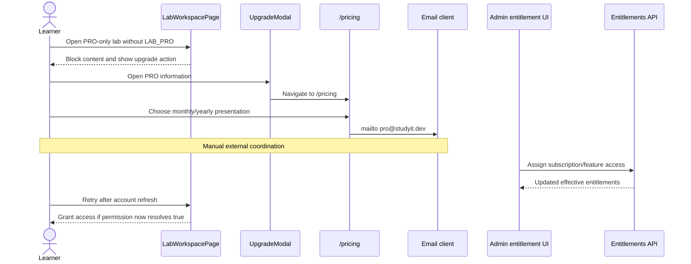

# PRO Access, Pricing, Manual Upgrade, and Payment Boundary

## 1. Document Information

| Attribute | Detail |
|---|---|
| Document | PRO Access, Pricing, Manual Upgrade, and Payment Boundary |
| Version | 2.0 |
| Owner | Nguyen Khanh Duy — Fullstack Lead & Architect |
| Scope | Current PRO gating/pricing and the boundary where automated checkout is not implemented |
| Date | 2026-10-24 |
| Source | Current frontend pricing/paywall, backend entitlement management, and database schema |

## 2. Content

### 2.1. Truth summary

| Capability | Status | Current behavior |
|---|---|---|
| PRO lab/solution gate | `IMPLEMENTED` | Permission checks show an upgrade modal instead of protected content. |
| Pricing comparison | `IMPLEMENTED` presentation | Monthly/yearly display and benefits are client-side content. |
| Upgrade request | `PARTIAL` | CTA opens email to `pro@studyit.dev`; there is no checkout request. |
| Plan/subscription data model | `IMPLEMENTED` | Admin can manage plans/features and assign a subscription to a user. |
| Effective entitlement enforcement | `IMPLEMENTED` | Backend resolves access and `FeatureEntitlementGuard` protects capabilities such as `SUBMIT_LAB`. |
| VNPAY/MoMo/VietQR/card processing | `EXTERNAL` / not implemented | No payment controller/service, order model, webhook, success route, or automated activation exists in this repository. |

### 2.2. Current learner flow

1. A `403` or local permission check for a PRO-only lab renders the gated state.
2. Upgrade modal explains benefits and routes to `/pricing`.
3. Pricing page toggles displayed monthly/yearly amounts locally; it does not load plans from the backend.
4. PRO CTA opens an email request. Activation, payment verification, and timing are operational/manual outside the application.
5. An administrator can assign a plan or direct feature override through the entitlement UI/API.
6. After user/session data is refreshed, feature access is resolved from the backend and protected features unlock accordingly.

### 2.3. Admin activation flow (`IMPLEMENTED`)

1. Admin opens the target user's entitlement details.
2. `GET /admin/users/:id/entitlements` returns current subscription, direct overrides, and effective features with provenance.
3. Admin selects a plan and optional duration/reason.
4. `POST /admin/users/:id/subscription` writes the subscription and records an audit event.
5. For exceptions, admin may set an expiring `ALLOW` or `DENY` override, or remove it to restore plan defaults.
6. `GET /entitlements/me` lets the authenticated client retrieve effective access; backend feature guards remain authoritative.

### 2.4. Data and authorization boundaries

| Area | Present model/API | Not present |
|---|---|---|
| Plans | `SubscriptionPlan`, feature mapping, admin CRUD | Dynamic pricing-page integration |
| User access | `UserSubscription`, group plans, direct feature overrides | Self-service purchase/renew/cancel |
| Enforcement | Effective feature resolver and feature guards | Payment-state-driven activation |
| Audit | Subscription/override administrative events | Payment/order/refund ledger |
| Payment | None | Payment order, gateway signature, return URL, IPN/webhook, reconciliation |

### 2.5. UI and failure states

- Paywall offers “Unlock with PRO” and “Browse Free Labs”.
- Pricing toggle is presentation-only; selecting it cannot fail because it makes no request.
- Email CTA depends on a configured mail client and manual response.
- Admin subscription/override failures are surfaced by entitlement UI feedback and must leave prior access unchanged.
- A learner must never be granted access based solely on client role text or the pricing selection; backend effective entitlements decide.

### 2.6. Future automated payment flow (`EXTERNAL`, not a current claim)

A production payment implementation would require a separately approved design and at least:

1. Server-created immutable payment order with user, plan, amount, currency, status, and idempotency key.
2. Provider redirect/session creation with secrets held only by the backend.
3. Signed webhook verification, replay prevention, amount/order validation, and transactional subscription activation.
4. Return/status page that reads server state rather than trusting query parameters.
5. Pending/paid/failed/expired/refunded lifecycle, reconciliation, audit, monitoring, and support tooling.
6. Legal, tax/invoice, refund, privacy, and deployment-secret decisions.

No provider, including VNPAY, should be described as selected or implemented until these artifacts exist.

### 2.7. Revision history and open issues

| Version | Date | Author | Note |
|---|---|---|---|
| 1.1 | 2026-10-14 | Nguyen Khanh Duy | Earlier design described a proposed VNPAY integration as implemented. |
| 2.0 | 2026-10-24 | StudyWeb engineering team | Corrected to current code: manual email/admin activation; payment gateway remains external. |

Open issues:

1. Decide whether automated payments are in scope and select a provider through a security/compliance review.
2. Connect pricing cards to backend plan data or clearly treat displayed amounts as marketing configuration.
3. The pricing page currently claims saved-series and multiple payment/support capabilities that are not backed by implemented flows; product copy should be reconciled.

## 3. References

- [Catalog and access discovery](02-catalog-topic-discovery.md)
- [Admin users and entitlements](09-admin-users-and-entitlements.md)
- [Admin plans, entitlements, and audit](18-admin-content-plans-and-audit.md)
- [`MODULE_FE/src/features/lab/components/UpgradeModal.tsx`](../../MODULE_FE/src/features/lab/components/UpgradeModal.tsx)
- [`MODULE_FE/src/pages/PricingPage.tsx`](../../MODULE_FE/src/pages/PricingPage.tsx)
- [`MODULE_FE/src/features/entitlements/api/entitlements.api.ts`](../../MODULE_FE/src/features/entitlements/api/entitlements.api.ts)
- [`MODULE_BE/src/modules/entitlements/entitlements.controller.ts`](../../MODULE_BE/src/modules/entitlements/entitlements.controller.ts)
- [`MODULE_BE/src/modules/entitlements/entitlements.service.ts`](../../MODULE_BE/src/modules/entitlements/entitlements.service.ts)
- [`MODULE_BE/prisma/schema.prisma`](../../MODULE_BE/prisma/schema.prisma)
