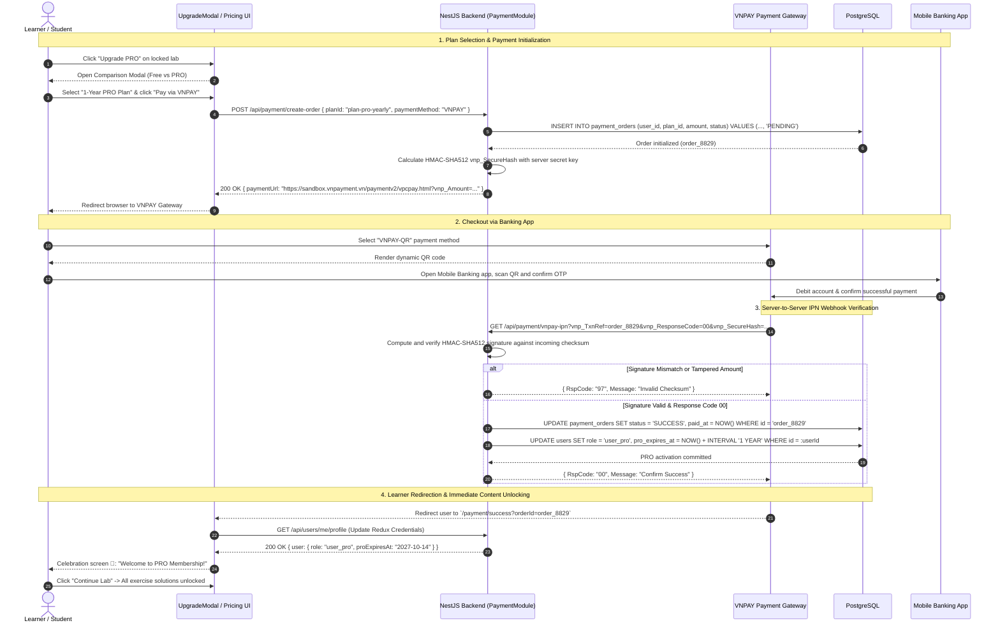

# Sequence Diagram: PRO Upgrade & VNPAY Payment Gateway Integration (Upgrade & Payment Flow)

## 1. Document Information

| Attribute | Details |
|---|---|
| **Document Title** | PRO Upgrade & VNPAY Payment Gateway Integration Workflow |
| **Version** | v1.1 |
| **Author** | Nguyen Khanh Duy (Fullstack Lead & Architect) |
| **Scope** | Learner conversion lifecycle from paywall modal trigger / pricing catalog, plan selection (Monthly / Yearly), payment intent initialization, secure redirection through VNPAY Gateway, HMAC-SHA512 IPN webhook verification, and instant PRO entitlement activation |
| **Date** | 2026-10-14 |
| **Source Reference** | `MODULE_FE/src/features/lab/components/UpgradeModal.tsx`, `MODULE_BE/src/modules/payment/payment.controller.ts`, `MODULE_BE/src/modules/payment/vnpay.service.ts` |

---

## 2. Core Content

### 2.1. Workflow Summary (TL;DR)
- **Input**: Learner interacts with a lab with `requiresPro = true` or clicks the "Upgrade PRO" button in the application header.
- **Plan Selection**: Displays Pricing modal, comparing Monthly (e.g. 199,000 VND) and Yearly (e.g. 1,490,000 VND) plans.
- **VNPAY Checkout**:
  - NestJS backend generates a signed payment URL with a cryptographic `vnp_SecureHash` (HMAC-SHA512).
  - Browser navigates to the VNPAY Gateway to render dynamic QR code scanning (VNPAY-QR) or local ATM/credit card entry.
- **Verification & Activation**:
  - VNPAY triggers a background server-to-server Instant Payment Notification (IPN) webhook to the backend to verify cryptographic checksums and transaction status.
  - Backend updates user role to `user_pro`, calculates expiration dates, and logs the transaction into `payment_orders`.
  - Learner is returned to the success celebration page with immediate access to all locked labs.

---

### 2.2. Roles & Responsibilities (Who Does What)

| Entity | Type | Roles & Responsibilities |
|---|---|---|
| **Learner** | Actor | Chooses subscription plan, scans QR code or submits banking payment |
| **UpgradeModal / Pricing UI** | Client UI | Highlights PRO benefits, renders pricing cards, initiates VNPAY checkout |
| **Payment Controller & Service** | NestJS Backend | Generates signed VNPAY redirect URLs, computes HMAC-SHA512, handles IPN Webhook |
| **VNPAY Gateway** | Payment Gateway | Processes banking transactions, manages redirects, dispatches IPN notifications |
| **PostgreSQL Database** | Storage | Houses `payment_orders` and updates `users` (`role = 'user_pro'`, `pro_expires_at`) |

---

### 2.3. Sequence Diagram

---

### 2.4. Technical Specifications & Architecture Details

1. **Dual Verification Architecture (Return URL vs IPN Webhook)**:
   - **Return URL (Client-Side)**: Provides seamless UI transition without forcing the user to wait.
   - **IPN Webhook (Server-to-Server)**: Authoritative channel for granting entitlements. Even if the user terminates their browser after completing the mobile bank transfer, the account is reliably activated by the IPN.
2. **Cryptographic Integrity via HMAC-SHA512**:
   - All query parameters are alphabetically ordered and hashed alongside the server secret `VNPAY_HASH_SECRET`. Any parameter tampering (`vnp_Amount`, `orderId`) causes checksum verification to fail immediately.
3. **Dynamic Subscription Stacking**:
   - For active PRO members renewing their subscriptions, additional duration is added to the existing `pro_expires_at` timestamp rather than overwriting from current time.

---

### 2.5. Edge Cases & Exception Handling

| Edge Case | System Response | User Experience |
|---|---|---|
| **User Cancels on VNPAY Gateway** | VNPAY redirects back with `vnp_ResponseCode = 24` | Displays friendly cancellation message with option to retry |
| **Network Loss During QR Scan** | VNPAY times out pending transaction after 15 minutes | Order transitions automatically to `EXPIRED` status |
| **Delayed IPN Due to Banking Congestion** | Frontend performs lightweight polling check | Displays spinner: *"Confirming your transaction with the bank..."* and auto-resolves when IPN lands |

---

## 3. References & Source Links

- **Frontend Codebase**:
  - Upgrade Modal: [UpgradeModal.tsx](file:///d:/Projects/study-web/MODULE_FE/src/features/lab/components/UpgradeModal.tsx)
- **Backend Codebase**:
  - Payment Controller: [payment.controller.ts](file:///d:/Projects/study-web/MODULE_BE/src/modules/payment/payment.controller.ts)
  - VNPAY Service: [vnpay.service.ts](file:///d:/Projects/study-web/MODULE_BE/src/modules/payment/vnpay.service.ts)
- **Related Workflows**:
  - Course Discovery & Paywall: [02-catalog-topic-discovery.md](file:///d:/Projects/study-web/docs/workflows/02-catalog-topic-discovery.md)
  - Submission & Progress: [04-lab-submission-progress.md](file:///d:/Projects/study-web/docs/workflows/04-lab-submission-progress.md)
  - Admin Users Governance: [09-admin-users-and-entitlements.md](file:///d:/Projects/study-web/docs/workflows/09-admin-users-and-entitlements.md)
