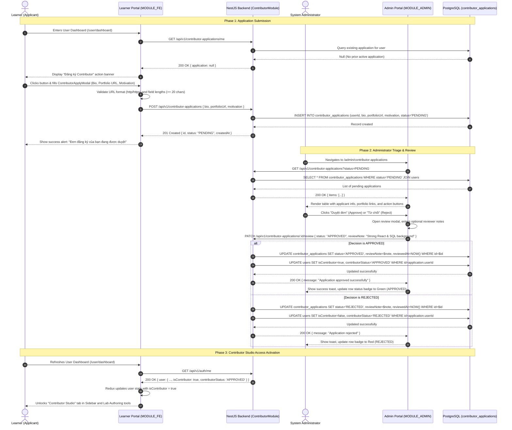

# Sequence Diagram: Contributor Onboarding & Application Review Lifecycle (Contributor Onboarding Flow)

## 1. Document Information

| Attribute | Details |
|---|---|
| **Document Title** | Contributor Onboarding & Application Review Lifecycle Workflow |
| **Version** | v1.0 |
| **Author** | Nguyen Khanh Duy (Fullstack Lead & Architect) |
| **Scope** | Complete end-to-end lifecycle for learners applying to become content contributors: Application submission via User Dashboard in `MODULE_FE`, persistence in PostgreSQL, triage & evaluation in `MODULE_ADMIN` (`/admin/contributor-applications`), state machine transitions (`PENDING` $\to$ `APPROVED` / `REJECTED`), and automatic activation of Contributor Studio entitlements |
| **Date** | 2026-10-15 |
| **Source Reference** | `MODULE_FE/src/features/contributor/components/ContributorApplyModal.tsx`, `MODULE_ADMIN/src/pages/admin/AdminContributorApplicationsPage.tsx`, `MODULE_BE/src/modules/contributor-application/contributor-application.controller.ts`, `MODULE_BE/src/modules/contributor-application/contributor-application.service.ts` |

---

## 2. Core Content

### 2.1. Workflow Summary (TL;DR)
- **Problem Solved**: Open and unrestricted content creation leads to low-quality lab authoring and catalog clutter. The Contributor Onboarding process introduces a gated qualification system ensuring only verified, capable educators author practice labs.
- **Phase 1 — Learner Application (`MODULE_FE`)**:
  - Authenticated learner opens User Dashboard (`/user/dashboard`) and clicks **"Trở thành Contributor"** (Become a Contributor).
  - Modal form collects: Brief Bio/Introduction, Portfolio / GitHub / LinkedIn URL, and Motivation statement.
  - Submits `POST /api/v1/contributor-applications`. Application state initialized to `PENDING`.
- **Phase 2 — Administrative Review (`MODULE_ADMIN`)**:
  - Administrator accesses `/admin/contributor-applications` on the dedicated administrative portal.
  - Views a paginated queue of applicants with filter pills (`ALL`, `PENDING`, `APPROVED`, `REJECTED`).
  - Evaluates profile qualifications, external portfolio links, and motivation.
  - Executes review decision via `PATCH /api/v1/contributor-applications/:id/review` with optional reviewer commentary.
- **Phase 3 — Permission Activation & Transition**:
  - **APPROVED**: Database updates user record (`isContributor = true`, `contributorStatus = 'APPROVED'`). Next session or token refresh unlocks the **Contributor Hub & Lab Studio** in the learner's dashboard.
  - **REJECTED**: Application recorded as `REJECTED` with feedback reasons visible to the applicant for future re-application.

---

### 2.2. Roles & Responsibilities (Who Does What)

| Entity | Type | Roles & Responsibilities |
|---|---|---|
| **Learner (Applicant)** | Actor | Fills out application credentials, links portfolio, and submits for contributor consideration |
| **Platform Administrator** | Actor | Evaluates submissions in `MODULE_ADMIN`, validates portfolios, and issues Approval or Rejection |
| **Apply Modal (`ContributorApplyModal`)** | Client UI (`MODULE_FE`) | Validates URL formatting, checks character length constraints, and renders submission status |
| **Admin Application Queue** | Client UI (`MODULE_ADMIN`) | `AdminContributorApplicationsPage`: Renders applicants table, status badges, and decision dialogs |
| **ContributorApplicationService** | NestJS Backend | Enforces single active application constraint, persists records, and transitions user role flags |
| **ContributorGuard** | Backend Guard | Protects lab and series creation endpoints (`POST /api/v1/labs`, `POST /api/v1/series`) against non-contributors |
| **PostgreSQL Database** | Storage | Houses `contributor_applications` table with relation to `users` |

---

### 2.3. Sequence Diagram



---

### 2.4. Technical Specifications & Architecture Details

1. **Database Schema (`contributor_applications`)**:
   ```prisma
   enum ContributorApplicationStatus {
     PENDING
     APPROVED
     REJECTED
   }

   model ContributorApplication {
     id           String                       @id @default(uuid())
     userId       String
     user         User                         @relation(fields: [userId], references: [id], onDelete: Cascade)
     bio          String                       @db.Text
     portfolioUrl String?
     motivation   String                       @db.Text
     status       ContributorApplicationStatus @default(PENDING)
     reviewNote   String?                      @db.Text
     reviewedAt   DateTime?
     reviewedById String?
     createdAt    DateTime                     @default(now())
     updatedAt    DateTime                     @updatedAt

     @@index([userId])
     @@index([status])
     @@map("contributor_applications")
   }
   ```
2. **Access Control Guard (`ContributorGuard`)**:
   - Implemented at `MODULE_BE/src/common/guards/contributor.guard.ts`.
   - Protects authoring endpoints by checking `req.user.isContributor === true || req.user.role === 'admin'`.
   - Rejects unauthorized authoring attempts with `403 Forbidden: "Chỉ tài khoản Contributor đã được phê duyệt mới có quyền tạo nội dung"`.
3. **Frontend Permission Gate**:
   - `MODULE_FE/src/features/auth/permissions.ts` defines capability `canAccessContributorStudio = (user) => Boolean(user?.isContributor || user?.role === 'admin')`.
   - Sidebar renders the Contributor Hub navlink with badge indicators (`Pending`, `Approved`, `Apply Now`).

---

### 2.5. Edge Cases & Exception Handling

| Edge Case | System Response | User Experience |
|---|---|---|
| **Multiple Simultaneous Submissions** | Backend queries existing applications with status `PENDING` | Form rejects secondary submission: *"Bạn đã có một đơn ứng tuyển đang chờ phê duyệt"* |
| **Invalid Portfolio URL Format** | Client & DTO validate `@IsUrl()` | Highlights field in red: *"Vui lòng nhập đường dẫn URL hợp lệ (ví dụ: https://github.com/...)"* |
| **Re-application After Rejection** | User allowed to submit a new application | Form re-opens with reminder to review previous admin feedback notes |
| **Contributor Rights Revocation** | Admin demotes user via `/admin/users` tab | Immediate revocation of `isContributor = false`; ongoing drafts locked |

---

## 3. References & Source Links

- **Frontend Codebase**:
  - Contributor Apply Modal: [ContributorApplyModal.tsx](file:///d:/Projects/study-web/MODULE_FE/src/features/contributor/components/ContributorApplyModal.tsx)
  - Contributor Application API: [contributor-application.api.ts](file:///d:/Projects/study-web/MODULE_FE/src/features/contributor/api/contributor-application.api.ts)
  - Admin Review Queue Page: [AdminContributorApplicationsPage.tsx](file:///d:/Projects/study-web/MODULE_ADMIN/src/pages/admin/AdminContributorApplicationsPage.tsx)
  - User Dashboard Overview: [DashboardOverviewView.tsx](file:///d:/Projects/study-web/MODULE_FE/src/pages/dashboard/views/DashboardOverviewView.tsx)
- **Backend Codebase**:
  - Contributor Application Controller: [contributor-application.controller.ts](file:///d:/Projects/study-web/MODULE_BE/src/modules/contributor-application/contributor-application.controller.ts)
  - Contributor Application Service: [contributor-application.service.ts](file:///d:/Projects/study-web/MODULE_BE/src/modules/contributor-application/contributor-application.service.ts)
  - Contributor Guard: [contributor.guard.ts](file:///d:/Projects/study-web/MODULE_BE/src/common/guards/contributor.guard.ts)
  - Prisma Schema: [schema.prisma](file:///d:/Projects/study-web/MODULE_BE/prisma/schema.prisma)
- **Related Workflows**:
  - Authentication & Session: [01-auth-login-to-home.md](file:///d:/Projects/study-web/docs/workflows/01-auth-login-to-home.md)
  - Two-Step Lab Studio: [06-create-lab-studio.md](file:///d:/Projects/study-web/docs/workflows/06-create-lab-studio.md)
  - Content Review Queue: [07-content-review-and-publish.md](file:///d:/Projects/study-web/docs/workflows/07-content-review-and-publish.md)
  - Admin User Governance: [09-admin-users-and-entitlements.md](file:///d:/Projects/study-web/docs/workflows/09-admin-users-and-entitlements.md)
