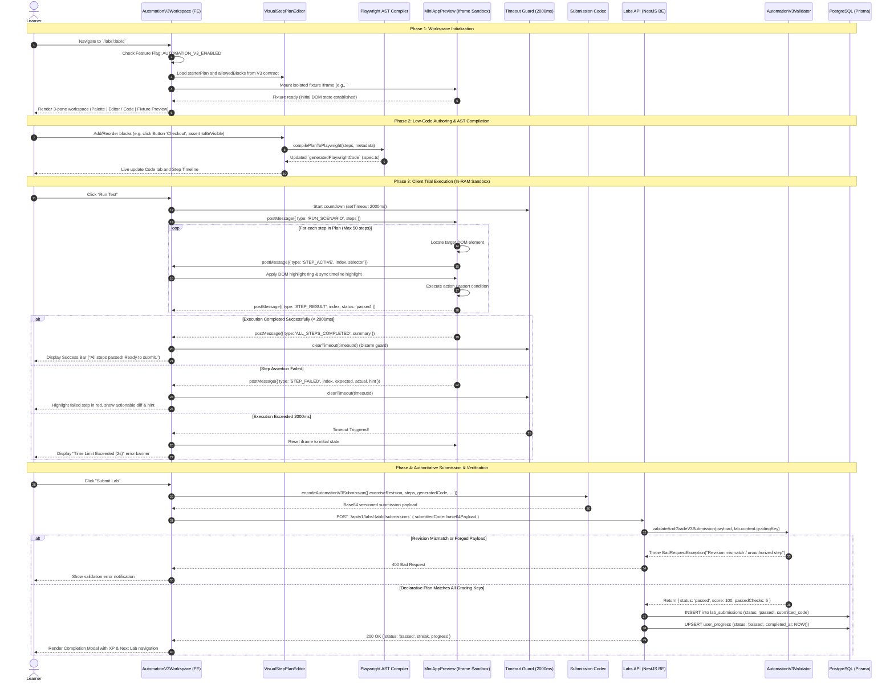

# Sequence Diagram: Automation V3 Client Sandbox & Low-Code Execution Flow

## 1. Document Information

| Attribute | Details |
|---|---|
| **Document Title** | Automation V3 Client Sandbox & Low-Code Execution Flow |
| **Version** | v3.0 |
| **Author** | Nguyen Khanh Duy (Fullstack Lead & Architect) |
| **Scope** | Complete client-side low-code test automation lifecycle: Visual step palette insertion, Playwright AST code generation, deterministic sandboxed iframe DOM execution, visual highlight rings, 2s safety disarm, versioned Base64 submission payload encoding, and backend declarative plan validation |
| **Date** | 2026-10-22 |
| **Source Reference** | `MODULE_FE/src/features/lab/strategies/AutomationV3Workspace.tsx`, `MODULE_FE/src/features/lab/components/v3/MiniAppPreview.tsx`, `MODULE_FE/src/features/lab/runtime/v3/playwrightCompiler.ts`, `MODULE_BE/src/modules/labs/automation-v3-validator.ts` |

---

## 2. Core Content

### 2.1. Workflow Summary (TL;DR)
- **Input**: Learner accesses an Automation V3 lab (`/labs/:labId`). The UI renders a 3-pane layout on desktop (or responsive tabs on mobile $\le 768$px) containing the Lab Guide, Block Palette/Visual Step Plan Editor, and Mini-App Preview.
- **Authoring & Code Generation**:
  - The learner adds, edits, or reorders declarative blocks (`Locator`, `Action`, `Assertion`, `Data`).
  - An AST compiler automatically generates clean, standalone Playwright TypeScript code adhering to web-first best practices (`page.getByRole()`, `expect(locator).toBeVisible()`).
- **Client Execution (0 Server Browser RAM)**:
  - On clicking **"Run Test"**, execution occurs entirely in client RAM.
  - The fixture runs inside a sandboxed `<iframe>` loaded with an isolated internal versioned web mini-app.
  - A Web Worker validates the plan, dispatches action commands over `postMessage`, highlights DOM elements in real time with a visual ring, and steps through assertions.
  - A strict **2000ms Timeout Guard** disarms infinite execution. Outbound network requests (`fetch`, XHR, WebSocket) are strictly prohibited via CSP.
- **Server Validation & Progress Authority**:
  - Upon submission, the client encodes a versioned Base64 envelope containing `exerciseRevision`, `stepPlan`, `answers`, `generatedPlaywrightCode`, `resultSummary`, and `durationMs`.
  - The backend (`MODULE_BE`) **does not launch any browser or Playwright process**. Instead, it executes deterministic declarative plan validation against a private `gradingKey` (checking required steps, forbidden patterns, and step integrity).
  - Valid submissions record an authoritative `passed` audit record in `lab_submissions` and upsert completion metrics in `user_progress`.

---

### 2.2. Roles & Responsibilities

| Entity | Type | Roles & Responsibilities |
|---|---|---|
| **Learner** | Actor | Selects/edits blocks, views generated Playwright `.spec.ts`, runs trial runs, and submits solutions |
| **Workspace Shell (`AutomationV3Workspace`)** | Client UI | 3-pane layout coordinator (Palette, Step Editor, Code Viewer, Mini-App Preview, and Step Timeline) |
| **Syntax Palette & Step Editor** | Client UI | Allowlist-governed block picker with category grouping (`navigation`, `locator`, `action`, `assertion`, `data`) |
| **AST Compiler (`playwrightCompiler`)** | Client Engine | Compiles declarative steps into idiomatic Playwright TypeScript specs with unique test titles and AAA structure |
| **Iframe Sandbox (`MiniAppPreview`)** | Client Sandbox | Renders isolated local fixture application, dispatches DOM events, highlights active selectors, and reports step outcomes |
| **Timeout Guard (2s)** | Safety Guard | Terminates runner if execution exceeds 2000ms, caps steps at 50, and caps console logs at 100 lines |
| **Submission Codec (`automationV3SubmissionCodec`)** | Client Serialization | Packages step plan, generated code, and diagnostic execution telemetry into a tamper-evident Base64 payload |
| **Backend Validator (`AutomationV3Validator`)** | Server Security | Validates version, revision, step allowlists, and scores against hidden `gradingKey` without browser execution |
| **Database (`Prisma / PostgreSQL`)** | Data Store | Records immutable submission audit log and updates user completion state |

---

### 2.3. Sequence Diagram

---

### 2.4. Safety, Resource Limits & Boundary Constraints

1. **Client RAM & Process Protection**:
   - Max 50 steps per execution plan.
   - Max 100 log lines per trial run.
   - 2000ms hard timeout guard with automatic iframe reset.
   - Zero external network requests: Any invocation of `fetch`, `XMLHttpRequest`, or `WebSocket` inside the runner is trapped and rejected by security guards.

2. **Server Zero-Browser Invariant**:
   - The backend server **never launches headless Chromium, Firefox, or WebKit** during learner submissions.
   - All evaluation on the backend is purely declarative (structural AST inspection, step type validation, parameter matching, and private grading key verification).
   - This prevents denial-of-service (DoS) via resource exhaustion and eliminates expensive cloud browser container costs.

3. **Tamper Resistance & Grading Key Isolation**:
   - `gradingKey` containing hidden verification checks and required steps is stripped by `labContentCodec` before lab metadata is sent to learners.
   - Submissions reporting client-side `status: 'passed'` are untrusted; the server computes the authoritative grade using the private `gradingKey`.

---

## 3. Architectural Cross-References

- **Parent Workspace Sequence**: [03-lab-practice-webworker.md](file:///d:/Projects/study-web/docs/workflows/03-lab-practice-webworker.md)
- **Submission & Progress Tracking**: [04-lab-submission-progress.md](file:///d:/Projects/study-web/docs/workflows/04-lab-submission-progress.md)
- **Content Contract V3**: [lab-content-contract-v3.md](file:///d:/Projects/study-web/docs/specs/lab-content-contract-v3.md)
- **Architecture Decision Record**: [003-client-automation-v3-sandbox-runner.md](file:///d:/Projects/study-web/docs/adr/003-client-automation-v3-sandbox-runner.md)
- **System Documentation Hub**: [docs/README.md](file:///d:/Projects/study-web/docs/README.md)
