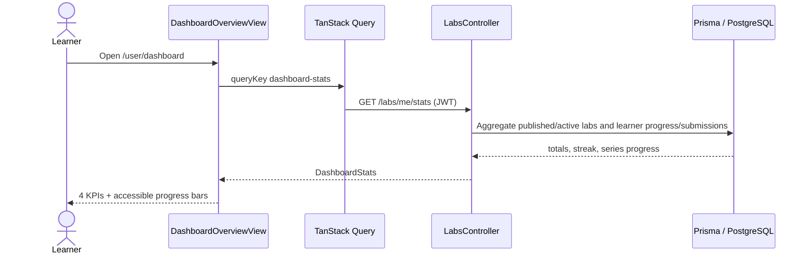

# Learner Dashboard, Saved Library, Submissions, and Progress

## 1. Document Information

| Attribute | Detail |
|---|---|
| Document | Learner Dashboard, Saved Library, Submissions, and Progress |
| Version | 1.0 |
| Owner | StudyWeb engineering team (inferred from repository) |
| Scope | `/user/dashboard` and learner-facing statistics, profile/library, submissions, and contributor transitions |
| Date | 2026-10-24 |
| Source | Current frontend routes/views and backend lab endpoints |

## 2. Content

### 2.1. Feature map

| Dashboard feature | Status | Route/API | Primary result |
|---|---|---|---|
| Overview metrics | `IMPLEMENTED` | `/user/dashboard`; `GET /labs/me/stats` | Completed/total labs, streak, overall and per-series progress. |
| Submission history | `IMPLEMENTED` | `/user/dashboard/submissions`; `GET /labs/user/submissions` | Searchable/filterable/sortable attempt history and KPIs. |
| Saved series | `PLACEHOLDER` | `/user/dashboard/saved` | Empty state and catalog link only; no bookmark storage/API. |
| Profile/access summary | `PARTIAL` | `/user/dashboard/profile`; `GET /auth/me` | Read-only account, contributor, access, and theme information. |
| Contributor workspace | `IMPLEMENTED` for authorized users | `/user/dashboard/content`, `/feedback`, `/labs/*` | Manage authored series/labs, review feedback, and studio routes. |
| Legacy contributor URLs | `IMPLEMENTED` redirects | `/contributor/*` | Redirects to canonical dashboard routes while preserving lab ID. |

### 2.2. Actors and access boundaries

| Actor | Access |
|---|---|
| Guest | Redirected away from `/user/dashboard/*` by `ProtectedRoute`. |
| Learner | Overview, profile, saved placeholder, and submission history. |
| Contributor | Learner features plus content, feedback, create/edit lab routes. |
| Admin | Treated as contributor-capable by current profile/permission logic. |
| Backend | Scopes metrics, progress, and submissions to `req.user.userId`. |

### 2.3. Dashboard overview flow (`IMPLEMENTED`)



Detailed behavior:

1. Protected route requires an authenticated client session.
2. `labApi.getDashboardStats()` calls `/labs/me/stats`; if that request fails, it attempts the compatibility alias `/labs/user/dashboard-stats`.
3. The backend computes completed labs without double-counting repeated passed attempts and excludes unpublished/inactive labs.
4. The UI derives overall completion percentage, caps it at 100%, and renders completed, total, streak, and progress KPIs.
5. Per-series rows show completed/total counts and an accessible progress bar.
6. “Continue learning” routes to `/series`; the current API does not return a last-active lab recommendation.

UI states:

- Loading: numeric ellipses and skeleton series rows.
- Empty: zero-safe KPIs and “no data” series message.
- Error: destructive banner with explicit retry.
- Success: metrics and series progress; query cache owns refetch behavior.

### 2.4. Submission history flow (`IMPLEMENTED`)

1. Opening `/user/dashboard/submissions` starts `GET /labs/user/submissions` with JWT.
2. Backend returns only the current user's attempts, including lab and series display metadata.
3. The page derives total attempts, passed attempts, failed attempts, and pass rate locally.
4. Search matches lab or series title; status filters are `all`, `passed`, or `failed`.
5. Sort options are newest, oldest, name ascending, and name descending.
6. Each row links back to `/labs/:slug` and optionally to `/series/:slug`.

Side effects: none; this view is read-only. Attempt creation and progress writes are defined in WF-04 and WF-17.

UI states:

- Loading: five row skeletons and placeholder KPI values.
- No attempts: explanation plus “Explore Practice Labs”.
- No filter match: distinct empty result with advice to change filters.
- Success: horizontally scrollable table with status badge, execution time, and timestamp.
- Current limitation: query errors are not rendered as a dedicated error/retry state in this view.

### 2.5. Saved-series library (`PLACEHOLDER`)

The `/user/dashboard/saved` route currently renders a static “No saved series yet” card and link to `/series`. There is no bookmark button contract, saved-series API, query, database model access, or persistence step in the view. It must remain labeled placeholder until those layers exist.

Expected future flow, not implemented:

1. Learner bookmarks/unbookmarks a series.
2. Backend persists a user-series relationship idempotently.
3. Saved route queries the relationship and handles loading/error/empty/content states.
4. Deleted/unpublished series are filtered or represented safely.

### 2.6. Profile and contributor transition

The profile uses the authenticated Redux user, refreshed through `GET /auth/me`. It does not issue a separate profile query or mutation. Contributor state branches are:

| State | UI action | Next flow |
|---|---|---|
| Contributor/admin | “Manage My Content & Studio” | `/user/dashboard/content` |
| Application `PENDING` | “View Application Status” | Contributor application modal/API |
| Standard learner | “Apply to Become a Contributor” | WF-13 application flow |

Contributor-only routes are nested under `ProtectedRoute requireContributor`; a direct URL must pass both authentication and contributor authorization. Legacy `/contributor/*` routes redirect to the canonical dashboard, including a parameter-preserving edit redirect.

### 2.7. Progress state and consistency

Dashboard values are server-derived from authoritative progress and successful submissions. The related lifecycle is:

```text
NOT_STARTED → IN_PROGRESS → COMPLETED
```

- Theory units use explicit start, position, and complete endpoints.
- Practice units create immutable attempt history and update the learner's current progress state.
- Repeated successful attempts must not inflate `totalCompleted`.
- Failed attempts remain visible in history but do not count as completion.
- Streaks are derived from qualifying activity dates and handle empty data safely.

### 2.8. Authorization, data effects, and observability

| Operation | Guard | Data behavior | Observability |
|---|---|---|---|
| Read overview stats | JWT | Aggregated read only | Backend tests cover zero, duplicate, failed, unpublished, and streak cases. |
| Read all submissions | JWT | Current-user scoped read | Attempt IDs/timestamps provide traceability. |
| Read profile | JWT | Current user read | No profile-view audit event. |
| Open contributor views | JWT + contributor route guard | No write until an authoring action | Review lifecycle provides later status evidence. |
| Saved series | Protected UI only | No persistence | Explicitly a placeholder. |

### 2.9. Revision history and open issues

| Version | Date | Author | Note |
|---|---|---|---|
| 1.0 | 2026-10-24 | StudyWeb engineering team | First full learner-dashboard flow based on current code. |

Open issues:

1. Implement bookmark persistence before presenting saved series as functional.
2. Add a visible error/retry state to submission history.
3. Replace dashboard API alias fallback once all deployments use `/labs/me/stats`.
4. Consider a server-provided “continue learning” target instead of catalog-only navigation.

## 3. References

- [Catalog and topic discovery](02-catalog-topic-discovery.md)
- [Submission and progress tracking](04-lab-submission-progress.md)
- [Contributor onboarding](13-contributor-onboarding-and-application.md)
- [`MODULE_FE/src/routes/index.tsx`](../../MODULE_FE/src/routes/index.tsx)
- [`MODULE_FE/src/pages/dashboard/views/DashboardOverviewView.tsx`](../../MODULE_FE/src/pages/dashboard/views/DashboardOverviewView.tsx)
- [`MODULE_FE/src/pages/dashboard/views/UserSavedSeriesView.tsx`](../../MODULE_FE/src/pages/dashboard/views/UserSavedSeriesView.tsx)
- [`MODULE_FE/src/pages/dashboard/views/UserLabSubmissionsView.tsx`](../../MODULE_FE/src/pages/dashboard/views/UserLabSubmissionsView.tsx)
- [`MODULE_FE/src/pages/dashboard/views/UserProfileView.tsx`](../../MODULE_FE/src/pages/dashboard/views/UserProfileView.tsx)
- [`MODULE_FE/src/features/lab/api/lab.api.ts`](../../MODULE_FE/src/features/lab/api/lab.api.ts)
- [`MODULE_BE/src/modules/labs/labs.controller.ts`](../../MODULE_BE/src/modules/labs/labs.controller.ts)
- [`MODULE_BE/src/modules/labs/labs.service.ts`](../../MODULE_BE/src/modules/labs/labs.service.ts)
