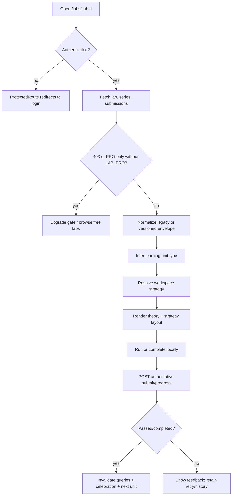
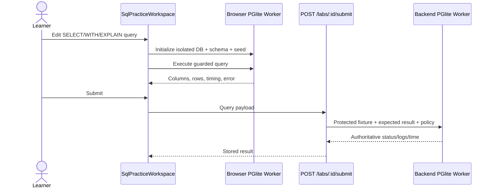

# Learning Unit Strategy Resolution and Execution Flows

## 1. Document Information

| Attribute | Detail |
|---|---|
| Document | Learning Unit Strategy Resolution and Execution Flows |
| Version | 1.0 |
| Owner | StudyWeb engineering team (inferred from repository) |
| Scope | `/labs/:labId`, content normalization, strategy routing, client execution, authoritative submission, and progress |
| Date | 2026-10-24 |
| Source | Current FE workspace/strategies and BE labs/grading implementation |

## 2. Content

### 2.1. Strategy matrix

| Pedagogical unit | Resolver input | Frontend strategy | Client execution | Server authority |
|---|---|---|---|---|
| Theory lesson | `markdown_only` | `TheoryLessonView` | Reading position and formative interaction | Explicit progress start/position/complete lifecycle |
| Quiz checkpoint | `quizlet` | `QuizAssignmentWorkspace` | Question navigation and provisional score | `QuizGradingService` re-grades answers; client pass is ignored |
| SQL practice | `sql_worker` | lazy `SqlPracticeWorkspace` | Isolated PGlite Web Worker preview | Separate PGlite grading worker evaluates protected expected output |
| Automation V1/V2 | `js_worker`, envelope not V3 | `AutomationTestWorkspace` | Sandboxed lab worker; Smart Cloze/config varies by envelope | Backend evaluates grading rules/config and stores its result |
| Automation V3 | envelope `3.0` + feature enabled, or `automation_v3` | `AutomationV3Workspace` | Block DSL → generated Playwright-style plan → in-memory mini-app runner | Versioned submission envelope decoded and checked against grading key/rules |
| Unknown/unsupported | unregistered `sandboxType` | `FallbackWorkspace` | No specialized execution | No implicit pass; authoring/config must be corrected |

### 2.2. Shared entry and orchestration flow

Shared behavior:

1. `useLabWorkspaceData` fetches lab detail, parent series, and the user's submissions, then normalizes content through the lab codec.
2. Public lab detail uses optional JWT so the backend can redact author-only fields for ordinary learners while preserving them for author/admin contexts.
3. PRO-only content is blocked when `LAB_PRO` permission is absent; solution visibility separately depends on `SOLUTION_ACCESS`.
4. The shell restores the starter snippet on lab transition, provides reset confirmation, curriculum search, previous/next navigation, and fullscreen controls.
5. SQL and legacy JS use a theory/workspace split on larger containers and 44px tab controls on small containers. Theory, quiz, and modern automation use a dedicated full-width strategy layout.
6. `useLabSubmission` posts the attempt, invalidates submission/series queries, and opens completion celebration only for a backend result of `passed`.

### 2.3. Theory lesson flow (`IMPLEMENTED`)

**Preconditions:** authenticated learner, published/accessible unit resolved to `markdown_only`.

1. Strategy renders instructional Markdown and current progress.
2. On first engagement, client calls `POST /labs/:id/progress/start`; backend idempotently transitions to `IN_PROGRESS`.
3. Scroll/position and formative answers call `POST /labs/:id/progress/position`.
4. Completion action calls `POST /labs/:id/progress/complete`, optionally with a score.
5. Backend upserts completion state and timestamp; dashboard aggregation can count completed learning-unit progress.

Errors and recovery: an absent record is treated as not started; repeated start/complete calls are designed around upsert/idempotent state transitions. Network failure must not be represented as persisted progress.

### 2.4. Quiz checkpoint flow (`IMPLEMENTED`)

1. Learner answers the configured question set in `QuizAssignmentWorkspace`; palette/navigation supports continuous review.
2. Client computes immediate formative feedback but serializes selected answers into the submission payload.
3. `POST /labs/:id/submit` requires JWT and `SUBMIT_LAB` entitlement.
4. Backend retrieves the protected quiz configuration and uses `QuizGradingService` to calculate score against `correctIndex` and threshold.
5. The server ignores any client-claimed pass/fail value, writes the authoritative attempt, and updates progress only from its own grade.
6. Public lab serialization removes `correctIndex`, explanations/hints where protected, and grading keys from ordinary learners.

Failure branches: missing/malformed answers grade safely; a quiz with no valid questions cannot produce a legitimate pass and is rejected by authoring release validation.

### 2.5. SQL practice flow (`IMPLEMENTED`, performance gate open)

Rules and recovery:

- Browser database is ephemeral and never points at platform PostgreSQL.
- Guard accepts a single read-oriented `SELECT`, `WITH`, or `EXPLAIN` statement and rejects DDL/DML/stacked statements.
- Reset closes and recreates the isolated database from deterministic schema/seed.
- Backend grader clamps timeout to 500–10,000 ms, runs in a worker, and terminates on timeout/crash.
- Learner payload never receives the protected expected result or mutable verification SQL.
- Current real-browser measurement passes cold-init/query/reset targets but the 10.01 MiB encoded PGlite asset exceeds the 4 MiB release budget.

### 2.6. Automation V1/V2 flow (`IMPLEMENTED` legacy compatibility)

1. `js_worker` resolves to `AutomationTestWorkspace` unless envelope `3.0` activates the V3 strategy.
2. Learner edits code or Smart Cloze blanks based on normalized envelope/config.
3. Execution occurs in a dedicated worker with timeout/error isolation; result panel displays logs and matcher outcomes.
4. Submission includes generated learner code/result evidence, but the backend derives the final status from protected grading rules/configuration.
5. Backend strips grading rules and hidden checks from ordinary learner reads and preserves them for privileged author/admin inspection.

This path exists for current legacy and V2 content. New block-based automation curriculum should use the V3 contract below.

### 2.7. Automation V3 flow (`IMPLEMENTED` behind feature flag)

1. Learner selects or arranges allowed visual blocks in `VisualStepPlanEditor`.
2. `blockDsl` validates block types/arguments; compiler produces a deterministic Playwright-style plan for display and execution.
3. Mini-app fixture runs in an in-memory iframe/sandbox model; the runner applies allowed operations, matchers, highlighting, and the safety timeout.
4. Client encodes revision, steps, generated code, and runtime evidence into a versioned base64 submission envelope.
5. Backend decodes defensively, rejects malformed payloads, revision mismatch, more than 50 steps, or unauthorized block types.
6. Backend checks required steps and forbidden patterns from the protected grading key/rules and determines pass/fail without launching a browser.
7. Author-only `gradingKey` and `solutionPlan` are removed from normal learner responses.

Feature-flag behavior: when envelope is `3.0` and `AUTOMATION_V3_ENABLED` is on, V3 wins regardless of legacy sandbox naming. If disabled, normal registry resolution applies.

### 2.8. Submission, persistence, and UI states

| Stage | UI state | Backend/data behavior |
|---|---|---|
| Load | Skeleton; data error; PRO upgrade gate | Optional-JWT lab read with security redaction |
| Edit/run | Local code/block/answer state and worker output | No platform DB mutation |
| Submit | Disabled/pending action | JWT + `SUBMIT_LAB`; server re-grades |
| Failed attempt | Logs/diff/feedback; retry available | Immutable submission stored; completion not granted |
| Passed attempt | Celebration and next-unit navigation | Submission stored; progress upserted completed |
| History | Theory pane/history or dashboard | Current user only; can restore submitted code where supported |

### 2.9. Security and open issues

Security boundaries:

- Client execution is untrusted and isolated; it is feedback, not grading authority.
- Backend retrieves protected configuration and overwrites client-reported status.
- Resource/entitlement guards control content access and submission.
- Author-only expected answers, grading keys, hidden checks, and solutions are redacted for learners.

Open issues:

1. Optimize or explicitly accept the PGlite first-use asset budget failure.
2. Retire legacy automation contracts only after all published content is migrated and backward compatibility is no longer required.
3. Keep feature-flag rollout evidence for Automation V3 deployment environments.

### 2.10. Revision history

| Version | Date | Author | Note |
|---|---|---|---|
| 1.0 | 2026-10-24 | StudyWeb engineering team | Unified full flow for all registered learning-unit strategies. |

## 3. References

- [Lab practice and worker execution](03-lab-practice-webworker.md)
- [Submission and progress](04-lab-submission-progress.md)
- [Automation V3 flow](14-automation-v3-client-sandbox-flow.md)
- [SQL browser benchmark](../reports/sql-engine-spike-benchmark.md)
- [Lab content contract V3](../specs/lab-content-contract-v3.md)
- [`MODULE_FE/src/pages/lab/LabWorkspacePage.tsx`](../../MODULE_FE/src/pages/lab/LabWorkspacePage.tsx)
- [`MODULE_FE/src/features/lab/strategies/workspaceRegistry.ts`](../../MODULE_FE/src/features/lab/strategies/workspaceRegistry.ts)
- [`MODULE_FE/src/features/lab/hooks/useLabSubmission.ts`](../../MODULE_FE/src/features/lab/hooks/useLabSubmission.ts)
- [`MODULE_FE/src/features/lab/sql-engine/sql-runner.worker.ts`](../../MODULE_FE/src/features/lab/sql-engine/sql-runner.worker.ts)
- [`MODULE_BE/src/modules/labs/labs.service.ts`](../../MODULE_BE/src/modules/labs/labs.service.ts)
- [`MODULE_BE/src/modules/labs/quiz-grading.service.ts`](../../MODULE_BE/src/modules/labs/quiz-grading.service.ts)
- [`MODULE_BE/src/modules/labs/sql-grading.service.ts`](../../MODULE_BE/src/modules/labs/sql-grading.service.ts)
- [`MODULE_BE/src/modules/labs/automation-v3-validator.ts`](../../MODULE_BE/src/modules/labs/automation-v3-validator.ts)
