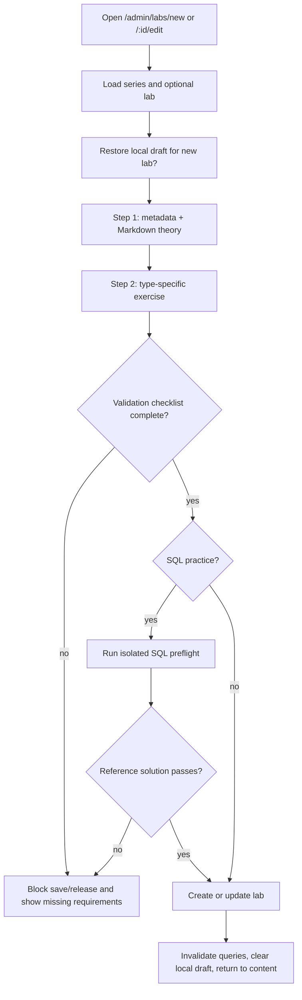
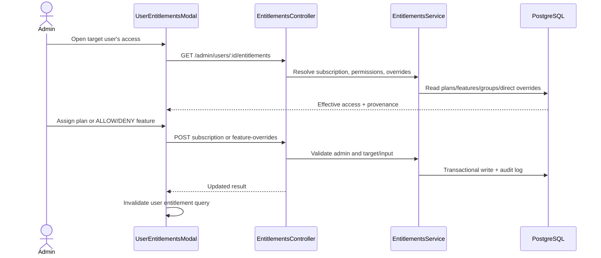

# Admin Content Authoring, Plans, Entitlements, Billing, and Audit

## 1. Document Information

| Attribute | Detail |
|---|---|
| Document | Admin Content Authoring, Plans, Entitlements, Billing, and Audit |
| Version | 1.1 — Billing Settings, Upgrade Queue, and Announcement Delivery |
| Owner | StudyWeb engineering team |
| Scope | `/admin/content`, `/admin/labs/*`, `/admin/plans` (Plans, Upgrade Queue, Billing Settings), `/admin/announcements`, entitlement controls in users, and `/admin/audit` |
| Date | 2026-10-26 |
| Source | Current Admin UI/API (`MODULE_ADMIN/src/pages/admin/`) and NestJS backend modules (`entitlements`, `billing`, `notifications`, `audit-logs`) |

## 2. Content

### 2.1. Feature map and roles

| Feature | Status | Primary actor | Result |
|---|---|---|---|
| Series/topic hierarchy CRUD | `IMPLEMENTED` | Admin | Create/edit/delete catalog parents and inspect child labs. |
| Topic tag governance | `IMPLEMENTED` | Admin | Maintain shared taxonomy used by catalog and authoring. |
| Admin lab studio | `IMPLEMENTED` | Admin | Create/edit theory, SQL, quiz, or automation lab configurations. |
| Review/publish lifecycle | `IMPLEMENTED` | Admin reviewer | Approve, request changes, reject, publish, unpublish, transfer ownership. |
| Subscription-plan CRUD & sale flags | `IMPLEMENTED` | Admin | Manage plan identity, price in integer VND, cycle, active, `isPublic`, and `isSaleReady` flags. |
| Receiving bank & intake settings | `IMPLEMENTED` | Admin | Configure bank name, bank code, account number, holder, instructions, and toggle `isIntakeEnabled`. |
| Upgrade request reconciliation queue | `IMPLEMENTED` | Admin | Filter/search upgrade requests; verify bank transactions; approve or reject with audited rationale. |
| Broadcast announcements & delivery | `IMPLEMENTED` | Admin | Compose system announcements, select audience, confirm count, and track batch delivery progress. |
| Shared notification inbox | `IMPLEMENTED` | Admin / Learner | Topbar dropdown with unread badge, 60s visible-tab polling, and read-state management. |
| Plan-feature mapping | `IMPLEMENTED` | Admin | Replace the feature set assigned to a plan. |
| User subscription and direct overrides | `IMPLEMENTED` | Admin | Assign plan; grant/deny a feature with reason/expiry; remove override. |
| Audit-log browser | `IMPLEMENTED` | Admin | Paginate/filter recorded entitlement, billing, plan, and security actions. |

All routes are behind the standalone admin application's `ProtectedRoute`. Backend admin endpoints additionally enforce JWT plus `RolesGuard` with role `admin`; hiding navigation is not the security boundary.

### 2.2. Admin content hierarchy flow

1. Admin opens `/admin/content`; `useAdminContent` loads series and related lab metadata.
2. Summary cards calculate total topics, labs, and PRO topics from the loaded model.
3. `AdminTopicHierarchy` renders parent series/topics and child labs.
4. Create/edit series opens `SeriesModal`; submit calls the series API and invalidates cached admin series.
5. Delete actions require UI confirmation and call the relevant series/lab endpoint; backend ownership/role rules remain authoritative.
6. “Manage Topic Tags” opens the taxonomy modal described in WF-08.
7. “Review Queue” routes to `/admin/review` for lifecycle actions described in WF-07.

### 2.3. Admin lab authoring flow



Detailed behavior:
- Parent series can determine the default pedagogical unit and sandbox type for a new lab.
- Step 1 captures series/section, title, objective, Markdown instructions, duration, order, active/PRO flags, and synchronized preview.
- Step 2 switches builder by unit type: SQL schema/query/result policy, quiz questions/correct answers/explanations, or automation starter/solution/tests/config.
- Draft form state auto-saves to browser storage after 1.5 seconds and can be restored for a new lab; this is local recovery, not server persistence.
- Validation requires a parent series, meaningful title/theory, and complete type-specific configuration.
- SQL authoring calls `POST /labs/sql/preflight`, which runs the reference solution in isolated PGlite. A SQL lab is not release-ready until preflight passes.
- Save uses `POST /labs` or `PUT /labs/:id`; query invalidation refreshes admin content.
- Contributor ownership gates do not replace admin authorization; backend DTO and release validations protect malformed quiz/automation/SQL content.

### 2.4. Plan management, public visibility, and sale readiness

1. `/admin/plans` provides three unified tabs: **Gói đăng ký** (`AdminPlansTab`), **Hàng đợi nâng cấp** (`AdminUpgradeRequestsTab`), and **Cấu hình thanh toán** (`AdminBillingSettingsTab`).
2. Plan CRUD allows setting `name`, `code`, `price` (integer VND), `billingCycle`, `isPublic`, and `isSaleReady`.
3. Safe public projection: Only plans with `isActive === true`, `isPublic === true`, and `isSaleReady === true` appear in the learner's public pricing endpoint (`GET /plans/public`).
4. Feature mapping: Admin toggles feature membership and saves via `PUT /admin/plans/:id/features`. Active subscriptions prevent accidental deletion of plans.

### 2.5. Billing settings and upgrade request reconciliation queue

```mermaid
sequenceDiagram
  autonumber
  actor Admin
  participant UI as AdminPlansPage (Queue Tab)
  participant API as Backend Billing API
  participant DB as PostgreSQL
  Admin->>UI: Filter by status (e.g. PENDING_REVIEW)
  UI->>API: GET /admin/upgrade-requests?status=PENDING_REVIEW
  API-->>UI: Paginated list of requests with transfer details & snapshots
  Note over Admin,UI: Admin inspects bank statement matching transferReference
  alt Manual Reconciliation Passed
    Admin->>UI: Click "Duyệt" -> Enter verifiedBankReference & verifiedAmount
    UI->>API: POST /admin/upgrade-requests/:id/approve
    API->>DB: Atomic update: verify amount/uniqueness, clamp renewal date, emit audit log & notification
    API-->>UI: Request approved; subscription activated/renewed
  else Reconciliation Failed / Fraudulent
    Admin->>UI: Click "Từ chối" -> Enter rejection reason
    UI->>API: POST /admin/upgrade-requests/:id/reject { reason }
    API->>DB: Atomic update: status -> REJECTED, reason saved, notification sent
    API-->>UI: Request marked rejected
  end
```

- **Billing Settings**: Managed under `AdminBillingSettingsTab` via `GET /admin/billing-settings` and `PUT /admin/billing-settings`. Configuration includes receiving bank name, bank code, account number, account holder name, custom transfer instructions, and the master toggle `isIntakeEnabled`.
- **Intake Safety Enforcement**: Intake cannot be toggled `true` without complete bank details. Disabling intake immediately pauses public purchase requests while preserving the ability for admins to reconcile and approve existing in-flight requests.
- **Queue Filters**: Admin can filter by status (`ALL`, `PENDING_REVIEW`, `AWAITING_PAYMENT`, `APPROVED`, `REJECTED`) and search across user names, emails, and transaction references.
- **Approval Modal**: Requires entering the verified bank reference number (must be unique across all approvals to prevent replay attacks) and verified amount (must match `priceSnapshot` exactly in VND).
- **Rejection Modal**: Requires an explicit, learner-facing reason (e.g., "Mã giao dịch không tìm thấy trên sao kê", "Số tiền chuyển không khớp").

### 2.6. Broadcast announcements and delivery progress

1. `/admin/announcements` (`AdminAnnouncementsPage`) allows administrators to compose broadcast messages to the learner base.
2. Composer features title, plain-text body, optional internal action path (validated against external URL redirection), and target audience selector (`ALL`, `user`, `userPro`).
3. Confirmation dialog displays estimated recipient count before submission.
4. Submission calls `POST /admin/announcements`. Backend creates the announcement and recipient records in `AnnouncementRecipient`.
5. Background runner delivers announcements in restartable batches with a progress bar displaying `processedRecipients / totalRecipients` and completion status.
6. The shared topbar notification dropdown (`AdminTopbar`) consumes the authenticated user's notification feed.

### 2.7. Effective entitlement resolution and user override flow

Effective access is computed on the backend, not inferred from the role badge alone. Resolution includes subscription plan features, permission mappings/group effects where configured, direct feature overrides, activation/expiry, and a deny/allow result with provenance.



Operations:
- Assign/upgrade: `POST /admin/users/:id/subscription`, optional duration and reason.
- Direct exception: `POST /admin/users/:id/feature-overrides` with `ALLOW` or `DENY`, mandatory reason, optional expiry.
- Restore plan default: `DELETE /admin/users/:id/feature-overrides/:featureCode`.
- Learner self-check: `GET /entitlements/me`; feature guards such as `SUBMIT_LAB` enforce the computed result.

### 2.8. Audit-log flow and limitations

1. `/admin/audit` requests `GET /admin/audit-logs?page=&limit=&action=` with a page size of 10.
2. Backend `AuditLogsService` returns newest paginated records and optional action/target filters.
3. UI filters the current page further by actor, target, or action text; it does not perform a global server-side text search.
4. Rows show timestamp, action badge, actor, target, reason, and a detail action.
5. Detail modal exposes the immutable snapshot JSON, actor/target IDs, IP, user agent context, and UTC timestamp.
6. Recorded actions include subscription assignments, billing setting updates, upgrade request approvals/rejections, feature `ALLOW`/`DENY`, and override removals.

### 2.9. Failure, safety, and consistency rules

| Area | Failure behavior | Safety rule |
|---|---|---|
| Content query | Loading/empty state or toast/error from hook | Do not mutate until current item/parent is resolved. |
| Local draft | Storage parse/quota failures are tolerated | Server remains source of truth after save. |
| Lab preflight | Failed SQL solution blocks readiness | Never run author SQL against platform PostgreSQL. |
| Plan mutations | Modal stays actionable; feedback reports failure | Active subscriptions protect plan deletion. |
| Upgrade approval | Uniqueness violation or amount mismatch blocks approval | Never double-credit or auto-approve mismatched transfers. |
| Entitlement override | API rejection leaves effective access unchanged | Reason and optional expiry are explicit; remove restores computed default. |
| Audit read | Empty criteria state; manual refetch | Audit endpoint is admin-only and read-only. |

### 2.10. Revision history and open issues

| Version | Date | Author | Note |
|---|---|---|---|
| 1.0 | 2026-10-24 | StudyWeb engineering team | First integrated admin content, plan, entitlement, and audit flow. |
| 1.1 | 2026-10-26 | StudyWeb engineering team | Documented billing settings tab, upgrade request reconciliation queue, announcement composer, delivery batch tracking, and plan public/sale-ready flags. |

Open issues:

1. Server-side actor/target text search in audit log remains paginated locally.
2. Browser-local lab drafts are device-specific and will benefit from server drafts in a future release.
3. Batch announcement runner currently operates on database queue leases without external Redis dependency.

## 3. References

- [Content review and publish lifecycle](07-content-review-and-publish.md)
- [Topic governance](08-admin-topic-governance.md)
- [User governance and entitlements](09-admin-users-and-entitlements.md)
- [PRO access and payment boundary](12-upgrade-and-payment.md)
- [Billing operations runbook](../runbooks/billing-operations-runbook.md)
- [`MODULE_ADMIN/src/routes/index.tsx`](../../MODULE_ADMIN/src/routes/index.tsx)
- [`MODULE_ADMIN/src/pages/admin/AdminPlansPage.tsx`](../../MODULE_ADMIN/src/pages/admin/AdminPlansPage.tsx)
- [`MODULE_ADMIN/src/pages/admin/AdminAnnouncementsPage.tsx`](../../MODULE_ADMIN/src/pages/admin/AdminAnnouncementsPage.tsx)
- [`MODULE_ADMIN/src/pages/admin/_components/AdminBillingSettingsTab.tsx`](../../MODULE_ADMIN/src/pages/admin/_components/AdminBillingSettingsTab.tsx)
- [`MODULE_ADMIN/src/pages/admin/_components/AdminUpgradeRequestsTab.tsx`](../../MODULE_ADMIN/src/pages/admin/_components/AdminUpgradeRequestsTab.tsx)
- [`MODULE_BE/src/modules/billing/`](../../MODULE_BE/src/modules/billing/)
- [`MODULE_BE/src/modules/notifications/`](../../MODULE_BE/src/modules/notifications/)

