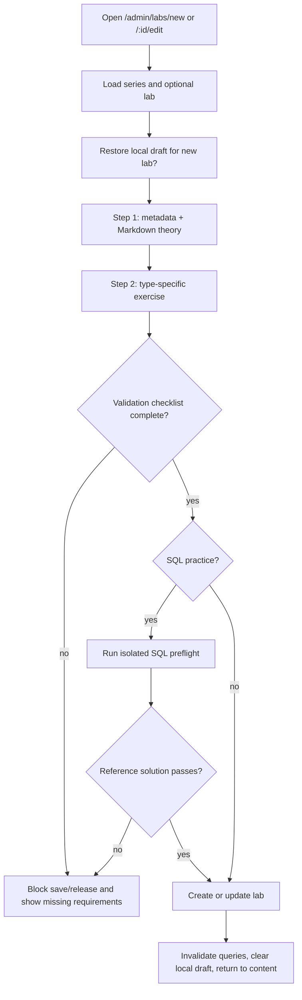
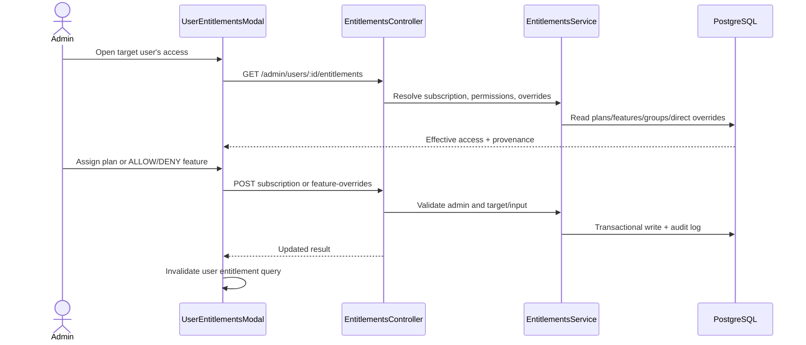

# Admin Content Authoring, Plans, Entitlements, and Audit

## 1. Document Information

| Attribute | Detail |
|---|---|
| Document | Admin Content Authoring, Plans, Entitlements, and Audit |
| Version | 1.0 |
| Owner | StudyWeb engineering team (inferred from repository) |
| Scope | `/admin/content`, `/admin/labs/*`, `/admin/plans`, entitlement controls in users, and `/admin/audit` |
| Date | 2026-10-24 |
| Source | Current Admin UI/API and NestJS authorization/data services |

## 2. Content

### 2.1. Feature map and roles

| Feature | Status | Primary actor | Result |
|---|---|---|---|
| Series/topic hierarchy CRUD | `IMPLEMENTED` | Admin | Create/edit/delete catalog parents and inspect child labs. |
| Topic tag governance | `IMPLEMENTED` | Admin | Maintain shared taxonomy used by catalog and authoring. |
| Admin lab studio | `IMPLEMENTED` | Admin | Create/edit theory, SQL, quiz, or automation lab configurations. |
| Review/publish lifecycle | `IMPLEMENTED` | Admin reviewer | Approve, request changes, reject, publish, unpublish, transfer ownership. |
| Subscription-plan CRUD | `IMPLEMENTED` | Admin | Manage plan identity, price, cycle, active/default state. |
| Plan-feature mapping | `IMPLEMENTED` | Admin | Replace the feature set assigned to a plan. |
| User subscription and direct overrides | `IMPLEMENTED` | Admin | Assign plan; grant/deny a feature with reason/expiry; remove override. |
| Audit-log browser | `IMPLEMENTED` for recorded admin events | Admin | Paginate/filter recorded entitlement and plan/security actions. |

All routes are behind the standalone admin application's `ProtectedRoute`. Backend admin endpoints additionally enforce JWT plus `RolesGuard` with role `admin`; hiding navigation is not the security boundary.

### 2.2. Admin content hierarchy flow

1. Admin opens `/admin/content`; `useAdminContent` loads series and related lab metadata.
2. Summary cards calculate total topics, labs, and PRO topics from the loaded model.
3. `AdminTopicHierarchy` renders parent series/topics and child labs.
4. Create/edit series opens `SeriesModal`; submit calls the series API and invalidates cached admin series.
5. Delete actions require UI confirmation and call the relevant series/lab endpoint; backend ownership/role rules remain authoritative.
6. “Manage Topic Tags” opens the taxonomy modal described in WF-08.
7. “Review Queue” routes to `/admin/review` for lifecycle actions described in WF-07.

UI states include loading hierarchy, zero-content actions, success/error toast, modal validation, and mutation pending controls.

### 2.3. Admin lab authoring flow

Detailed behavior:

- Parent series can determine the default pedagogical unit and sandbox type for a new lab.
- Step 1 captures series/section, title, objective, Markdown instructions, duration, order, active/PRO flags, and synchronized preview.
- Step 2 switches builder by unit type: SQL schema/query/result policy, quiz questions/correct answers/explanations, or automation starter/solution/tests/config.
- Draft form state auto-saves to browser storage after 1.5 seconds and can be restored for a new lab; this is local recovery, not server persistence.
- Validation requires a parent series, meaningful title/theory, and complete type-specific configuration.
- SQL authoring calls `POST /labs/sql/preflight`, which runs the reference solution in isolated PGlite. A SQL lab is not release-ready until preflight passes.
- Save uses `POST /labs` or `PUT /labs/:id`; query invalidation refreshes admin content.
- Contributor ownership gates do not replace admin authorization; backend DTO and release validations protect malformed quiz/automation/SQL content.

### 2.4. Plan and feature registry flow

1. `/admin/plans` concurrently loads `GET /admin/plans` and `GET /admin/features`.
2. Admin may create a plan with code, name, description, price, billing cycle, and default flag.
3. Edit changes name/description/price/cycle/active/default state through `PUT /admin/plans/:id`.
4. Delete requires confirmation; backend refuses deletion when protected by active subscription relationships, and UI advises deactivation instead.
5. Selecting a plan copies its feature IDs into local selection state.
6. Admin toggles feature membership and saves the complete set through `PUT /admin/plans/:id/features`.
7. Successful mutations invalidate `admin-plans`; failures show the backend message or a generic error.

Feature registration is supported by `POST /admin/features`, although the current plans page primarily consumes the registry for mapping.

### 2.5. Effective entitlement resolution and user override flow

Effective access is computed on the backend, not inferred from the role badge alone. Resolution includes subscription plan features, permission mappings/group effects where configured, direct feature overrides, activation/expiry, and a deny/allow result with provenance.

Operations:

- Assign/upgrade: `POST /admin/users/:id/subscription`, optional duration and reason.
- Direct exception: `POST /admin/users/:id/feature-overrides` with `ALLOW` or `DENY`, mandatory reason, optional expiry.
- Restore plan default: `DELETE /admin/users/:id/feature-overrides/:featureCode`.
- Learner self-check: `GET /entitlements/me`; feature guards such as `SUBMIT_LAB` enforce the computed result.

### 2.6. Audit-log flow and limitations

1. `/admin/audit` requests `GET /admin/audit-logs?page=&limit=&action=` with a page size of 10.
2. Backend `AuditLogsService` returns newest paginated records and optional action/target filters.
3. UI filters the current page further by actor, target, or action text; it does not perform a global server-side text search.
4. Rows show timestamp, action badge, actor, target, reason, and a detail action.
5. Detail modal exposes the immutable snapshot JSON, actor/target IDs, IP, user agent context, and UTC timestamp.
6. Manual refresh refetches the current query; pagination changes the server page.

Recorded actions include subscription assignment, feature `ALLOW`/`DENY`, override removal, plan/feature operations where the corresponding service emits an audit record. The audit page should not be described as a complete log of every admin content/review/user operation unless each service writes those events.

### 2.7. Failure, safety, and consistency rules

| Area | Failure behavior | Safety rule |
|---|---|---|
| Content query | Loading/empty state or toast/error from hook | Do not mutate until current item/parent is resolved. |
| Local draft | Storage parse/quota failures are tolerated | Server remains source of truth after save. |
| Lab preflight | Failed SQL solution blocks readiness | Never run author SQL against platform PostgreSQL. |
| Plan mutations | Modal stays actionable; feedback reports failure | Active subscriptions protect plan deletion. |
| Entitlement override | API rejection leaves effective access unchanged | Reason and optional expiry are explicit; remove restores computed default. |
| Audit read | Empty criteria state; manual refetch | Audit endpoint is admin-only and read-only. |

### 2.8. Data effects and observability

| Feature | Main records affected | Cache/UI refresh | Audit evidence |
|---|---|---|---|
| Series/lab authoring | Series, section, lab/content envelope | Admin series/lab queries | Review history tracks lifecycle; general content audit coverage is not universal. |
| Plan CRUD/mapping | SubscriptionPlan, Feature, plan-feature join | `admin-plans` | Service-dependent plan/feature audit actions. |
| Assign subscription | User subscription and effective entitlements | Target entitlement/user queries | `ASSIGN_SUBSCRIPTION`. |
| Feature exception | UserFeatureOverride | Target entitlement/user queries | `FEATURE_OVERRIDE_ALLOW`, `FEATURE_OVERRIDE_DENY`, removal action. |
| Audit browsing | None | Paginated/refetched query | Reads existing immutable records only. |

### 2.9. Revision history and open issues

| Version | Date | Author | Note |
|---|---|---|---|
| 1.0 | 2026-10-24 | StudyWeb engineering team | First integrated admin content, plan, entitlement, and audit flow. |

Open issues:

1. Expand audit coverage if product policy requires every content/review/user mutation to be logged.
2. Server-side actor/target text search is absent; current search filters only the loaded audit page.
3. Browser-local lab drafts are device-specific and need a server draft model for cross-device recovery.
4. Production admin-domain and non-admin rejection checks remain a manual deployment gate.

## 3. References

- [Content review and publish lifecycle](07-content-review-and-publish.md)
- [Topic governance](08-admin-topic-governance.md)
- [User governance and entitlements](09-admin-users-and-entitlements.md)
- [Admin deployment gate](../deployment/admin-subdomain-setup.md)
- [`MODULE_ADMIN/src/routes/index.tsx`](../../MODULE_ADMIN/src/routes/index.tsx)
- [`MODULE_ADMIN/src/pages/admin/AdminContentPage.tsx`](../../MODULE_ADMIN/src/pages/admin/AdminContentPage.tsx)
- [`MODULE_ADMIN/src/pages/admin/AdminLabStudioPage.tsx`](../../MODULE_ADMIN/src/pages/admin/AdminLabStudioPage.tsx)
- [`MODULE_ADMIN/src/pages/admin/_components/AdminPlansTab.tsx`](../../MODULE_ADMIN/src/pages/admin/_components/AdminPlansTab.tsx)
- [`MODULE_ADMIN/src/pages/admin/_components/AdminAuditLogsTab.tsx`](../../MODULE_ADMIN/src/pages/admin/_components/AdminAuditLogsTab.tsx)
- [`MODULE_BE/src/modules/entitlements/entitlements.controller.ts`](../../MODULE_BE/src/modules/entitlements/entitlements.controller.ts)
- [`MODULE_BE/src/modules/entitlements/entitlements.service.ts`](../../MODULE_BE/src/modules/entitlements/entitlements.service.ts)
- [`MODULE_BE/src/modules/audit-logs/audit-logs.controller.ts`](../../MODULE_BE/src/modules/audit-logs/audit-logs.controller.ts)
- [`MODULE_BE/src/modules/labs/labs.service.ts`](../../MODULE_BE/src/modules/labs/labs.service.ts)
